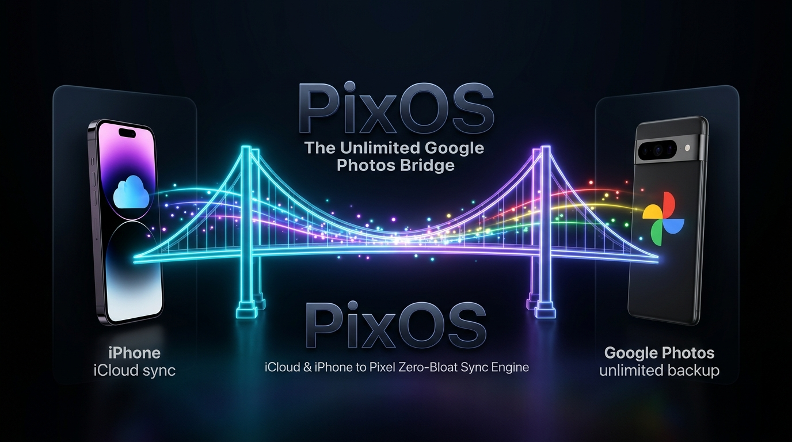
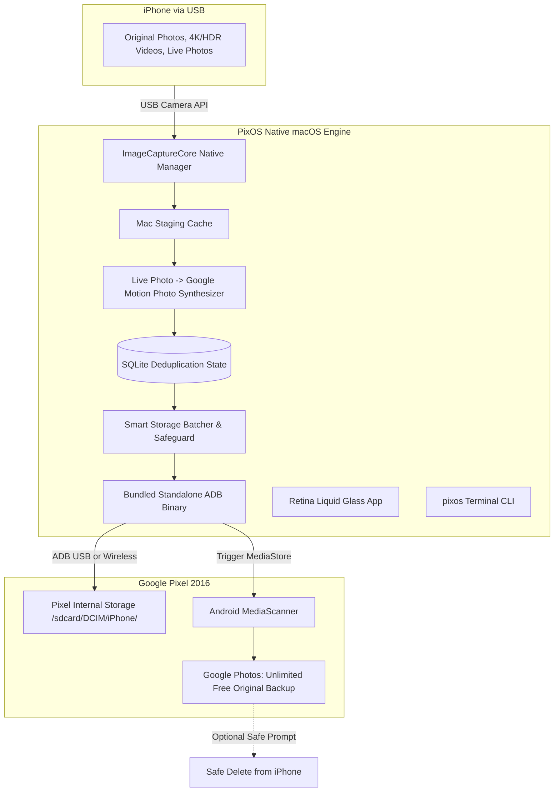

<p align="center">
  
</p>

# PixOS ⇄ 

> **Bypass iCloud Storage Fees Forever.** The native macOS app and CLI utility that extracts full-resolution photos, 4K videos, and Live Photos from your iPhone or iCloud and syncs them to Google Pixel via ADB for lifetime free unlimited original-quality Google Photos cloud backups.

[](https://opensource.org/licenses/MIT)
[-black?logo=apple)](https://apple.com)
[](https://swift.org)
[]()
[]()

---

## 🌟 Why PixOS?

The **original 2016 Google Pixel (OG Pixel / sailfish / marlin)** comes with a unique lifetime perk: **free, unlimited original-quality photo and video backup to Google Photos forever**.

If you own an iPhone and are tired of paying Apple $36 to $360 every year for expanding iCloud storage tiers (50GB, 200GB, 2TB), PixOS gives you a seamless bridge:
1. **Direct iCloud or USB Sourcing**: Source directly from your **iCloud Photos Library** (even if your iPhone has "Optimize iPhone Storage" enabled and only keeps 3 local thumbnails) or connect directly via USB cable.
2. Connect your Google Pixel to your Mac (via USB cable or **Wireless Wi-Fi ADB**).
3. **Zero-Disk-Bloat Micro-Staging**: PixOS downloads each full-resolution original on demand, automatically merges Live Photos into **Google Motion Photos** with official XMP metadata, stages and pushes them via ADB to `/sdcard/DCIM/iPhone/`, triggers Android media scanning, and **instantly deletes the local file from your Mac SSD**. Your Mac never runs out of space!
4. Google Photos on your Pixel immediately uploads them to the cloud at **100% original quality** without consuming a single byte of your Google account storage.
5. **Tinder-Like Swipe Cleaner**: Once backed up to Pixel, launch the interactive 3D card deck to swipe right (Keep in iCloud) or swipe left (Purge from iCloud) to instantly free up your paid cloud quota.

---

## 📸 Key Features

- **Direct iCloud Photo Library Streaming**: Seamlessly queries your synced iCloud library using Apple's native PhotoKit framework. No passwords or scraping needed—streams full originals and Live Photo `.MOV` videos on-the-fly directly from Apple's iCloud CDN.
- **Zero-Disk-Bloat Pipeline**: Engineered specifically for MacBooks with limited SSD space. Transfers in strict 1-in-1-out micro-staging, purging local files from `~/.pixos/staging/` immediately after transfer. Monitored with live macOS disk space telemetry.
- **Tinder-Style iCloud Swipe Triage**: A fluid, responsive 3D card swipe UI (`ICloudSwipeCleanView`) with gesture tracking, keyboard shortcuts (← / → / Z), undo rollback, live reclaimed storage counter, and Apple native batch confirmation sheet.
- **Liquid Glass macOS Desktop App**: Designed with Apple Retina Liquid Glass vibrancy, live device status pulses (iPhone USB & Pixel ADB), interactive storage gauges, and real-time speed & progress monitors.
- **Apple Live Photos → Google Motion Photos**: Injects standardized Google Camera XMP container metadata (`Camera:MotionPhoto="1"`) and multiplexes your 3-second companion `.MOV` video directly into the photo. Google Photos renders and animates them natively!
- **Bundled Standalone ADB**: Comes with prepackaged `adb` binary. No Android Studio, no Homebrew, and no terminal installation needed for non-technical users.
- **Dual-Mode ADB (USB & Wi-Fi)**: Keep your Pixel on its charging stand across the room and connect wirelessly over local Wi-Fi via Wireless ADB.
- **Smart Batching & Storage Safeguard**: Avoids overwhelming your Pixel's 32GB/128GB disk. Transfers in configurable batches, checks free storage before each item, and pauses gracefully if space is low.
- **Local SQLite Deduplication**: Tracks synced media fingerprints in `~/.pixos/sync_state.db`. Subsequent syncs automatically skip already-backed-up media.
- **Full-Featured Terminal CLI (`pixos`)**: Scriptable command-line tool with color-coded tables, `--icloud` flags, dry-run options, and batch controls for power workflows.

---

## 🚀 Quick Start (Download App)

1. Download the latest **`PixOS-1.6.0.dmg`** from [Releases](https://github.com/exactablehq/PixOS/releases).
2. Open the DMG and drag **`PixOS.app`** to your **`/Applications`** folder.
3. Launch PixOS:
   - **Zero-Click CLI Setup**: PixOS automatically installs `pixos` and `adb` command line tools to your system PATH during initial onboarding.
   - **Connect Devices**:
     - **iPhone / iPad**: Plug in via Lightning / USB-C, unlock your phone, and tap **"Trust This Computer"** if prompted. Select your device from the dropdown if multiple are connected.
     - **Google Pixel**: Enable **Developer Options** and turn on **USB Debugging**. Plug in via USB, or open **Wireless ADB** to scan the QR code directly with your Pixel's camera.
4. Click **"Start Sync to Pixel"**.

---

## 💻 Terminal CLI Usage (`pixos`)

If you prefer using the terminal, PixOS compiles to a standalone, universal CLI binary:

```bash
# Check device connections, storage, and database statistics
pixos status

# List all discovered iOS source devices and Android target devices
pixos devices

# Start interactive sync with 5GB batch limit
pixos sync --batch-size 5G

# Transfer all pending media in a single unrestricted batch
pixos sync --unlimited

# Target a specific iPhone source and Android device serial
pixos sync --source "iPhone 15 Pro" --target "FA6980301042"

# Dry run (scan camera roll and compute pending transfers without pushing)
pixos sync --dry-run

# Connect to Google Pixel wirelessly over Wi-Fi
pixos connect-wireless 192.168.1.150

# View backup history and stats
pixos history
```

### CLI Flags:
| Option | Description | Default |
|---|---|---|
| `--batch-size <GB>` | Maximum size per batch before pausing | `5G` |
| `--unlimited` | Transfer all pending media without batching | `false` |
| `--source <id/name>` | Select specific iPhone/iPad as source | First detected |
| `--target <serial>` | Select specific Android device as target | First authorized |
| `--no-motion-photos` | Push Live Photo companion MOV separately | `false` |
| `--exclude-screenshots`| Skip screenshots and screen recordings | `false` |
| `--exclude-videos` | Skip standalone video files | `false` |
| `--pixel-path <path>` | Remote destination folder on Pixel | `/sdcard/DCIM/iPhone` |
| `--delete-after` | Prompt to safely delete backed-up items from iPhone | `false` |
| `--dry-run` | Preview pending media without transferring | `false` |

---

## 🏗️ Architecture & Pipeline



---

## 🛠️ Building From Source

### Prerequisites:
- macOS 14.0 (Sonoma) or macOS 15.0+ (Sequoia)
- Xcode Command Line Tools (`xcode-select --install`)
- Swift 5.9 or Swift 6.0+

### Steps:
```bash
# 1. Clone repository
git clone https://github.com/exactablehq/PixOS.git
cd PixOS

# 2. Run test suite
swift run --build-system native test-runner

# 3. Build CLI binary
swift build -c release --build-system native --product pixos

# 4. Build native macOS .app and distributable .dmg
bash scripts/package_dmg.sh
```
The packaged DMG is saved to `dist/PixOS-1.0.0.dmg`.

---

## ❓ Frequently Asked Questions

<details>
<summary><strong>Why does the original 2016 Google Pixel have unlimited storage?</strong></summary>
When Google launched the original Pixel in 2016, they included a lifetime contractual pledge of free unlimited original quality Google Photos uploads for any media uploaded through the device. This policy has never been revoked and applies to all photos and videos pushed to the device.
</details>

<details>
<summary><strong>Will my photos or 4K videos be compressed?</strong></summary>
No. PixOS extracts the pristine original files from your iPhone without transcoding. Photos (HEIC/JPEG), ProRAW DNGs, and 4K HDR videos are uploaded in 100% untouched original quality.
</details>

<details>
<summary><strong>How does PixOS handle Apple Live Photos?</strong></summary>
iPhones record Live Photos as a paired still image and a 3-second MOV video. PixOS synthesizes a standard Google Camera Motion Photo by injecting XMP metadata (`Camera:MotionPhoto="1"`) and concatenating the video stream. Google Photos recognizes and plays them as native motion photos.
</details>

<details>
<summary><strong>Is it safe to delete backed-up photos from my iPhone?</strong></summary>
PixOS is strictly read-only by default. After a batch is transferred and verified on the Pixel, PixOS displays an optional prompt to delete backed-up media from the iPhone. It will never delete any file without your explicit confirmation.
</details>

---

## 🤝 Contributing

Contributions are warmly welcomed! Please read our [Contributing Guide](CONTRIBUTING.md) and [Code of Conduct](CODE_OF_CONDUCT.md).

1. Fork the Project
2. Create your Feature Branch (`git checkout -b feature/AmazingFeature`)
3. Commit your Changes (`git commit -m 'Add some AmazingFeature'`)
4. Push to the Branch (`git push origin feature/AmazingFeature`)
5. Open a Pull Request

---

## 📄 License

Distributed under the **MIT License**. See [`LICENSE`](LICENSE) for more information.

Copyright © 2026 **Exactable** ([exactablehq](https://github.com/exactablehq)).
